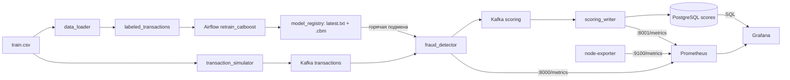

# Антифрод: мониторинг потокового скоринга в Prometheus и Grafana

Сервис скоринга фродовых транзакций из прошлых заданий, к которому добавлена наблюдаемость. Kafka несёт непрерывный поток транзакций, CatBoost скорит их текущей моделью, Airflow переобучает модель и публикует новые версии, `scoring_writer` пишет результаты в PostgreSQL. Сервисы отдают метрики Prometheus, Grafana строит по ним дашборды и алерты, а срез по версиям модели, штатам и мерчантам читает прямо из PostgreSQL.

Датасет: файл `train.csv` из [соревнования](https://www.kaggle.com/competitions/teta-ml-1-2025/data), путь задаётся переменной `TRAIN_DATA_CSV` в `.env`.

---

## Быстрый старт

```bash
git clone <ссылка на этот репозиторий>
cd <папка репозитория>
cp .env.example .env
# в .env укажите путь к train.csv в TRAIN_DATA_CSV
docker compose up -d --build
```

Нужны Docker и Docker Compose v2. Первый запуск собирает образы и загружает витрину, это занимает несколько минут. Поток пойдёт, когда Kafka станет healthy и `kafka-setup` создаст топики. Состояние контейнеров:

```bash
docker compose ps
```

После старта откройте Grafana: http://localhost:3000, логин `admin`, пароль `admin`. При первом входе Grafana предлагает сменить пароль, кнопка Skip оставляет `admin` / `admin`. Домашняя страница сразу показывает дашборд скоринга, остальные лежат в папке **Fraud monitoring** (Dashboards).

## Адреса

| Что | Адрес |
|-----|-------|
| Grafana | http://localhost:3000 (`admin` / `admin`) |
| Дашборд скоринга | http://localhost:3000/d/fraud-scoring |
| Дашборд записи в БД | http://localhost:3000/d/fraud-writer |
| Дашборд системных метрик | http://localhost:3000/d/fraud-node |
| Бизнес-срез по штатам и мерчантам | http://localhost:3000/d/fraud-business |
| Алерты Grafana | http://localhost:3000/alerting/list |
| Prometheus | http://localhost:9090 |
| Цели Prometheus (все должны быть UP) | http://localhost:9090/targets |
| Метрики скоринга | http://localhost:8000/metrics |
| Метрики записи в БД | http://localhost:8001/metrics |
| Метрики Node Exporter | http://localhost:9100/metrics |
| Kafka UI | http://localhost:8080 |
| Airflow | http://localhost:8081 (`admin` / `admin`) |
| PostgreSQL | `localhost:5432`, база `fraud_db`, `fraud_user` / `fraud_pass` из `.env` |

---

## Архитектура



| Сервис | Что делает |
|--------|------------|
| **transaction_simulator** | Каждые 0.1 секунды шлёт в `transactions` случайную строку CSV с новым `transaction_id` и текущим временем |
| **fraud_detector** | Препроцессинг и CatBoost. Перед каждым сообщением читает `/models/latest.txt` и подхватывает новую модель без перезапуска. Отдаёт метрики на `:8000` |
| **scoring_writer** | Читает топик `scoring` и пишет скор, флаг, версию модели, штат, мерчанта, категорию и сумму в таблицу `scores`. Отдаёт метрики на `:8001` |
| **airflow** | DAG `retrain_catboost` каждые 5 минут переобучает модель на сдвинутом окне и публикует `my_catboost_<версия>.cbm`, DAG `supply_labeled_batch` дописывает размеченные месяцы |
| **Prometheus** | Раз в секунду забирает метрики `fraud_detector`, `scoring_writer` и Node Exporter, считает recording rules |
| **Grafana** | Источники Prometheus и PostgreSQL, четыре дашборда и три правила алертов, всё подключается через provisioning при старте |
| **node-exporter** | Системные метрики машины с контейнерами: CPU, память, сеть, диск |
| **fraud_attack** | Второй симулятор, шлёт только фродовые строки. Запускается вручную с профилем `attack` для проверки алерта |

Все сервисы находятся в одной сети `ml-scorer`. Контракт скоринга не менялся: сервис читает `transactions` и отдаёт в `scoring` список с `transaction_id`, `score`, `fraud_flag` и `model_version`. Рядом со скором теперь передаются поля транзакции `us_state`, `merch`, `cat_id` и `amount`, чтобы строить по ним срезы в Grafana.

---

## Дашборды

Все дашборды лежат в `grafana/dashboards/*.json` и подключаются провайдером `grafana/provisioning/dashboards/dashboards.yaml`. Источники данных описаны в `grafana/provisioning/datasources/datasources.yaml`: Prometheus (`uid fraud-prometheus`) и PostgreSQL (`uid fraud-postgres`), логин и пароль базы Grafana берёт из `.env`. Дашборды обновляются раз в 5–10 секунд, интервал можно поменять справа сверху.

### Fraud 1. Скоринг транзакций — `/d/fraud-scoring`

| Блок | Панели |
|------|--------|
| Сейчас | скорость потока (TPS), отскорено с запуска, доля фрода среди последних 500 транзакций, версия модели в скоринге, задержка Kafka → скор p95, ошибки за 5 минут |
| Поток и доля фрода | **скорость обработки по версиям модели** (столбики окрашены версией, после подмены цвет меняется), **доля транзакций, помеченных как фрод** (окно 500 транзакций и за минуту, пунктир — порог алерта 12%) |
| Время обработки и скоры | **время обработки одной транзакции** (среднее, p50, p95, p99), **распределение скоров во времени** (heatmap по корзинам гистограммы) |
| Собственные метрики скоринга | время стадий обработки p95, задержка от записи в Kafka до скора, ошибки по стадиям, квантили скоров |

На всех графиках этого дашборда включена аннотация **Смена модели**: красная полоса примерно на 30 секунд с подписью `Новая модель <версия>`.

### Fraud 2. Запись результатов в PostgreSQL — `/d/fraud-writer`

| Блок | Панели |
|------|--------|
| Сейчас | скорость записи, записано с запуска, выявлено фрода, время записи p95, ошибки записи, строк в таблице `scores` |
| Скорость и время записи | скорость записи в БД по версиям модели, время записи одного скора (среднее, p50, p95, p99) |
| Выявленный фрод и записанные скоры | число записанных транзакций с `fraud_flag = 1` за 30 секунд, распределение записанных скоров во времени |
| Срез из PostgreSQL | **таблица «Скоры и доля фрода по версиям модели»** (число скоров, помечено как фрод, доля фрода, средний скор, первый и последний скор каждой версии), доля фрода по версиям, скоров в секунду по версиям по данным БД |

Здесь две аннотации: **Смена модели** из Prometheus и **Версия появилась в БД**, которая берётся запросом `min(created_at)` по каждой `model_version` в `scores`. На одном экране видно и то, что процесс жив (метрики Prometheus), и то, какая версия модели что насчитала (PostgreSQL).

### Fraud 3. Системные метрики — `/d/fraud-node`

CPU, память, заполненность диска, load average, число ядер и аптайм в верхней строке. Ниже загрузка CPU по режимам, память (занято, кэш, доступно), сеть (приём вверх, передача вниз), диск (чтение и запись в байтах и операциях в секунду), заполненность файловых систем.

### Fraud 4. Бизнес-срез по штатам и мерчантам — `/d/fraud-business`

Дашборд читает таблицу `scores` из PostgreSQL. Сверху два фильтра: **Штат** (`us_state`) и **Мерчант** (`merch`), оба с множественным выбором и значением All. Список мерчантов сужается под выбранные штаты. Все панели пересчитываются под фильтры.

| Панель | Что показывает |
|--------|----------------|
| Транзакций в выборке, доля фрода, сумма помеченных, средний скор | итоги по выбранным штатам и мерчантам за интервал времени |
| Плотность распределения скоров | 20 корзин по 0.05, высота — доля транзакций в корзине, делённая на ширину корзины, ось логарифмическая |
| TPS обработки выбранных транзакций | сколько транзакций с выбранными штатами и мерчантами скорилось в секунду, отдельно помеченные как фрод |
| Доля фрода по категориям, последние 1000 транзакций | средний `fraud_flag` по `cat_id` среди последних 1000 записанных транзакций |
| Деньги под подозрением (свой график) | столбцы — сумма `amount` у транзакций, которые модель пометила как фрод, за минуту, линия — какая доля всего оборота за минуту ушла бы на блокировку или ручную проверку |
| Мерчанты с наибольшим числом подозрительных транзакций (свой график) | топ-15 мерчантов по числу помеченных транзакций с долей фрода и суммой |

Зачем свои графики. Доля фрода в штуках не говорит, сколько денег под угрозой: десяток помеченных покупок по $1000 важнее сотни по $5. График «Деньги под подозрением» показывает нагрузку на антифрод-команду и потенциальные потери, а резкий рост доли оборота при обычном числе транзакций — повод проверить модель или источник атаки. Таблица мерчантов отвечает на вопрос, с кого начинать разбор инцидента.

---

## Метрики

Имена у метрик скоринга начинаются с `scorer_`, у записи в БД — с `writer_`. Значения обновляются на каждом обработанном сообщении.

### fraud_detector — http://localhost:8000/metrics

| Метрика | Тип | Метки | Смысл |
|---------|-----|-------|-------|
| `scorer_transactions_total` | counter | `model_version` | отскоренные и отправленные в `scoring` транзакции |
| `scorer_flagged_total` | counter | `model_version` | транзакции с `score > 0.5` |
| `scorer_processing_seconds` | histogram | — | время обработки одной транзакции от разбора JSON до отправки скора |
| `scorer_score` | histogram | — | распределение скоров, корзины мельче у нуля |
| `scorer_fraud_share` | gauge | — | доля помеченных как фрод среди последних 500 транзакций |
| `scorer_fraud_share_window_size` | gauge | — | сколько транзакций сейчас в этом окне (меньше 500 сразу после старта) |
| `scorer_model_switches_total` | counter | `version` | горячая подмена модели: +1 с меткой новой версии, когда сервис подхватил новый файл без перезапуска |
| `scorer_model_info` | gauge | `version` | версия, которой сервис скорит сейчас, значение 1 |
| `scorer_stage_seconds` | histogram | `stage` | время стадий `preprocess`, `predict`, `produce` |
| `scorer_event_lag_seconds` | histogram | — | задержка от записи транзакции в Kafka (timestamp сообщения) до готового скора |
| `scorer_errors_total` | counter | `stage` | сообщения, которые не удалось обработать: `decode`, `preprocess`, `predict`, `produce` |

### scoring_writer — http://localhost:8001/metrics

| Метрика | Тип | Метки | Смысл |
|---------|-----|-------|-------|
| `writer_scores_written_total` | counter | `model_version` | скоры, записанные в `scores` |
| `writer_fraud_written_total` | counter | `model_version` | записанные транзакции с `fraud_flag = 1` |
| `writer_db_write_seconds` | histogram | — | время `INSERT` и `COMMIT` одного скора |
| `writer_score` | histogram | — | распределение записанных скоров |
| `writer_errors_total` | counter | `reason` | `bad_message` — сообщение не того формата, `db_error` — ошибка PostgreSQL |
| `writer_db_reconnects_total` | counter | — | переподключения к PostgreSQL после обрыва соединения |

### Node Exporter — http://localhost:9100/metrics

Стандартные `node_cpu_seconds_total`, `node_memory_*`, `node_network_*`, `node_disk_*`, `node_filesystem_*`, `node_load1`.

### Recording rules — `prometheus/rules.yml`

| Ряд | Что считает |
|-----|-------------|
| `job:scorer_transactions:rate30s` | TPS скоринга за 30 секунд |
| `job:scorer_flagged_share:rate1m` | доля помеченных за минуту по счётчикам |
| `job:scorer_processing_seconds:p95_1m` | p95 времени обработки за минуту |
| `job:scorer_event_lag_seconds:p95_1m` | p95 задержки Kafka → скор за минуту |
| `job:writer_scores_written:rate30s` | скорость записи в БД |
| `job:writer_db_write_seconds:p95_1m` | p95 времени записи |

Их удобно смотреть в Prometheus: http://localhost:9090/query, вкладка Graph.

### Метрики, которых нет в коде семинара

**`scorer_event_lag_seconds` — задержка от Kafka до скора.** Главная собственная метрика. TPS и время обработки одного сообщения могут выглядеть нормально, а скоринг при этом отстаёт от потока: сообщения копятся в топике, и скор для транзакции появляется через минуты, когда платёж уже прошёл. Метрика берёт timestamp, с которым симулятор записал сообщение в Kafka, и вычитает его из момента готовности скора, то есть показывает реальную свежесть ответа. Где смотреть: дашборд **Fraud 1**, панель «Задержка от записи в Kafka до скора» (p50, p95, p99) и плитка «Задержка Kafka → скор, p95» в верхней строке. На ней же построен алерт «Скоринг отстаёт от потока».

**`scorer_stage_seconds{stage}` — время по стадиям.** Показывает, что именно тормозит при росте времени обработки: препроцессинг pandas, инференс CatBoost или отправка в Kafka. В момент подмены модели виден всплеск `predict`: первое сообщение после публикации ждёт загрузки нового файла. Панель «Время стадий обработки, p95» на **Fraud 1**.

**`scorer_errors_total{stage}` — ошибки по стадиям.** В семинаре исключение только пишется в лог, и по графикам не отличить «поток стих» от «все сообщения падают». Панели «Ошибки за 5 минут» и «Ошибки обработки по стадиям» на **Fraud 1**.

**`scorer_model_info{version}` — текущая версия модели.** Плитка «Модель в скоринге» на **Fraud 1** показывает, какой версией считаются скоры прямо сейчас, без захода в контейнер.

**`scorer_fraud_share` по скользящему окну.** В семинаре доля фрода считалась от старта сервиса и через час работы почти не двигалась. Здесь это доля среди последних 500 транзакций, она реагирует на всплеск за секунды, поэтому на ней построен алерт.

---

## Отметка смены версии модели

1. DAG `retrain_catboost` обучает модель, кладёт `my_catboost_<версия>.cbm` в общий том `model_registry` и атомарно переписывает `latest.txt`.
2. `fraud_detector` перед каждым сообщением читает `latest.txt`, видит новую версию и загружает файл без перезапуска контейнера.
3. Сервис увеличивает `scorer_model_switches_total{version="<новая версия>"}` и переключает `scorer_model_info` на новую версию.
4. Grafana на дашбордах **Fraud 1** и **Fraud 2** выполняет аннотационный запрос

   ```promql
   scorer_model_switches_total > (scorer_model_switches_total offset 30s or scorer_model_switches_total * 0)
   ```

   Ряд возвращается, пока счётчик версии вырос за последние 30 секунд или только что появился. Поэтому на графиках появляется красная полоса около 30 секунд с подписью `Новая модель <версия>`. Если та же версия будет опубликована повторно, счётчик вырастет с 1 до 2, и отметка тоже появится.

Первая загрузка модели при старте контейнера подменой не считается и счётчик не увеличивает.

### Как проверить

Ждать не обязательно, первое переобучение начинается через пару минут после старта Airflow, дальше каждые 5 минут. Запустить вручную:

```bash
docker compose exec airflow airflow dags trigger retrain_catboost
```

или кнопкой Trigger в Airflow (http://localhost:8081). Прогон занимает около минуты. Затем на **Fraud 1** появится красная полоса, в легенде «Скорость обработки по версиям модели» добавится новая версия, плитка «Модель в скоринге» сменится, а в таблице «Скоры и доля фрода по версиям модели» на **Fraud 2** появится новая строка.

Опубликованные модели:

```bash
docker compose exec airflow ls -la /opt/airflow/models
```

Быстрая проверка без обучения: скрипт копирует текущую модель под новой версией `manual_<время>` и переписывает `latest.txt`, как это делает DAG. Веса те же, но механизм подмены и отметка на графике проверяются за секунды:

```bash
docker compose exec fraud_detector python tools/publish_copy.py
```

---

## Как убедиться, что метрики идут с потока

1. Цели Prometheus: http://localhost:9090/targets, `fraud_detector`, `scoring_writer`, `node_exporter` и `prometheus` в состоянии UP.
2. Счётчик растёт между двумя запросами примерно на 10 в секунду:

   ```bash
   curl -s localhost:8000/metrics | grep '^scorer_transactions_total'
   curl -s localhost:8001/metrics | grep '^writer_scores_written_total'
   ```

   В PowerShell вместо `grep` можно открыть эти адреса в браузере.
3. На **Fraud 1** плитка «Скорость потока» показывает около 10 TPS, графики двигаются.
4. Остановите поток и посмотрите, как TPS падает до нуля, а затем верните его:

   ```bash
   docker compose stop transaction_simulator
   docker compose start transaction_simulator
   ```

5. Строки в базе:

   ```bash
   docker compose exec postgres psql -U fraud_user -d fraud_db -c "SELECT model_version, count(*), avg(fraud_flag) FROM scores GROUP BY 1 ORDER BY min(created_at);"
   ```

---

## Алерты

Правила лежат в `grafana/provisioning/alerting/alert_rules.yaml` и появляются после запуска в **Alerting → Alert rules**, папка **Fraud alerts**, группа `scoring`. Группа вычисляется раз в 10 секунд. Доставка в Telegram или почту не настроена, состояние Normal / Pending / Firing видно в списке правил. Каждое правило привязано к панели дашборда **Fraud 1**, поэтому там же у панели появляется значок состояния алерта.

| Правило | Условие | Держится | Как вызвать | Как вернуть |
|---------|---------|----------|-------------|-------------|
| Доля фрода выше 12% | `max(scorer_fraud_share) > 0.12` | 30 с | `docker compose --profile attack up -d --build fraud_attack` | `docker compose --profile attack stop fraud_attack` |
| Поток транзакций остановился | `sum(rate(scorer_transactions_total[30s])) < 1` TPS, нет данных тоже считается срабатыванием | 1 мин | `docker compose stop transaction_simulator` | `docker compose start transaction_simulator` |
| Скоринг отстаёт от потока больше чем на 5 секунд | p95 `scorer_event_lag_seconds` за минуту `> 5` с | 20 с | `docker compose pause fraud_detector`, подождать минуту, `docker compose unpause fraud_detector` | очередь разберётся сама, алерт погаснет через минуту |

Пояснения к порогам.

- **12% фрода.** Порог подобран прогоном моделей по публичному датасету Sparkov, из которого сделан `train.csv` соревнования: время транзакций заменялось на текущее, как это делает симулятор, по разным часам суток. В обычном потоке исходная модель `initial` помечает 0.1–0.4% транзакций, модель после переобучения DAG (`auto_class_weights="Balanced"`) — 2.6–6.3%. Сервис `fraud_attack` из профиля `attack` шлёт около 40 фродовых транзакций в секунду поверх обычных 10. Тогда доля среди последних 500 поднимается до 19–44% у модели `initial` (меньше всего утром: время суток — признак модели) и до 59–66% у переобученной. 12% лежат между этими диапазонами с запасом в несколько стандартных отклонений окна из 500 транзакций. Через 30 секунд выше порога правило переходит в Firing.
- **1 TPS.** Симулятор шлёт около 10 транзакций в секунду, ниже 1 поток можно считать остановленным. Запрос с `or vector(0)` даёт ноль, даже если контейнер скоринга упал и метрик нет совсем. В первую минуту после `docker compose up`, пока Kafka и симулятор поднимаются, это правило может коротко сработать: поток действительно ещё не идёт.
- **5 секунд задержки.** Обычно скор готов через десятки миллисекунд после записи в Kafka. Пауза контейнера скоринга на минуту копит в топике около 600 транзакций, после `unpause` они скорятся с задержкой до минуты, p95 за минуту уходит выше 5 секунд, и правило срабатывает.

---

## Таблица scores

| Поле | Тип | Описание |
|------|-----|----------|
| id | SERIAL | уникальный ID |
| transaction_id | TEXT | идентификатор транзакции |
| score | FLOAT | вероятность мошенничества, порог 0.5 |
| fraud_flag | INT | 1, если score больше 0.5 |
| model_version | TEXT | версия CatBoost, которая посчитала скор |
| us_state | TEXT | штат клиента |
| merch | TEXT | мерчант |
| cat_id | TEXT | категория покупки |
| amount | DOUBLE PRECISION | сумма транзакции |
| created_at | TIMESTAMP | время записи |

Если таблица осталась от прошлых заданий, `scoring_writer` при старте добавит недостающие колонки и индексы на `created_at` и `model_version`.

---

## Что изменено относительно кода семинара

- Новый набор метрик скоринга и записи в БД со своими именами, метками версии модели, гистограммами вместо Summary и метриками, которых в семинаре нет (задержка Kafka → скор, стадии, ошибки, текущая версия модели, доля фрода по окну).
- Обработка ошибок разделена по стадиям, у `scoring_writer` откат транзакции и переподключение к PostgreSQL.
- В топик `scoring` и таблицу `scores` добавлены `us_state`, `merch`, `cat_id`, `amount` для срезов.
- Своя конфигурация Prometheus с метками сервисов и recording rules.
- Свои четыре дашборда, PostgreSQL-источник, аннотация смены модели, которая ловит и повторную публикацию версии.
- Алерты через provisioning, профиль `attack` и скрипт `tools/publish_copy.py` для проверки.
- Версии образов Prometheus, Grafana, Node Exporter и Kafka UI зафиксированы, у сервисов есть healthcheck и `restart: unless-stopped`.

---

## Структура проекта

```
.
├── fraud_detector/
│   ├── app/app.py            # чтение Kafka, скоринг, отправка результата
│   ├── app/metrics.py        # метрики scorer_*
│   ├── src/                  # препроцессинг и горячая подмена модели
│   ├── tools/publish_copy.py # ручная публикация версии для проверки отметки
│   └── models/my_catboost.cbm
├── scoring_writer/app.py     # запись в PostgreSQL и метрики writer_*
├── transaction_simulator/    # поток транзакций, режим FRAUD_ONLY для атаки
├── data_loader/              # первичная загрузка витрины
├── dags/, pipeline/, airflow/ # переобучение и поставка размеченных месяцев
├── prometheus/
│   ├── prometheus.yml        # цели и интервал сбора 1 секунда
│   └── rules.yml             # recording rules
├── grafana/
│   ├── provisioning/datasources/datasources.yaml
│   ├── provisioning/dashboards/dashboards.yaml
│   ├── provisioning/alerting/alert_rules.yaml
│   └── dashboards/           # scoring, writer, node, business
├── docker-compose.yml
├── .env.example
└── README.md
```

---

## Очистка

```bash
docker compose --profile attack down -v
```

Удаляет контейнеры вместе с витриной, реестром моделей, состоянием Airflow и томами Prometheus и Grafana. Следующий запуск снова загрузит CSV.

## Ограничения

- Счётчики Prometheus живут в памяти сервиса и обнуляются при перезапуске контейнера. Скорости и доли на графиках от этого не страдают, плитки «с запуска» начинают с нуля.
- Node Exporter работает в общей сети `ml-scorer`, поэтому панель сети показывает интерфейс его контейнера. На Docker Desktop (Windows, macOS) CPU, память и диск — это метрики виртуальной машины Docker.
- Задержка Kafka → скор считается по часам контейнеров. На одной машине они общие, так что метрика точная.
